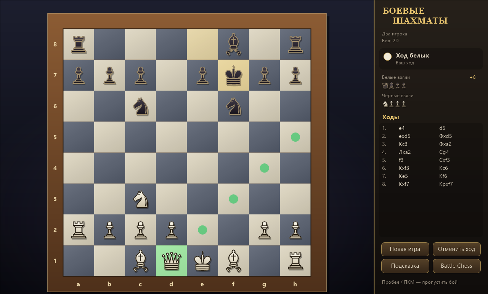
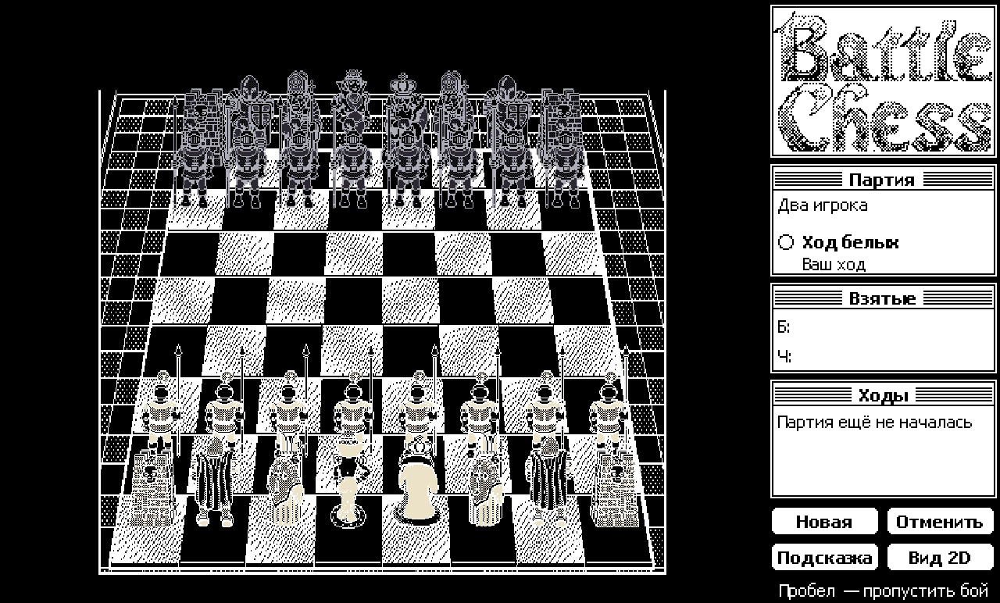
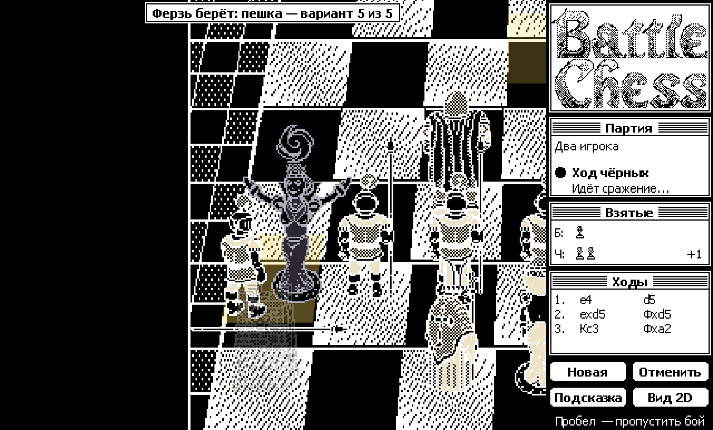
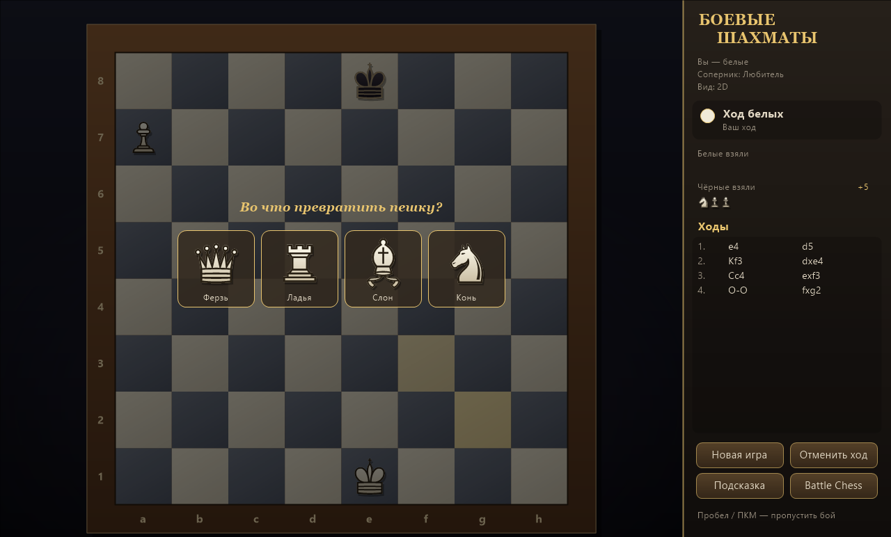
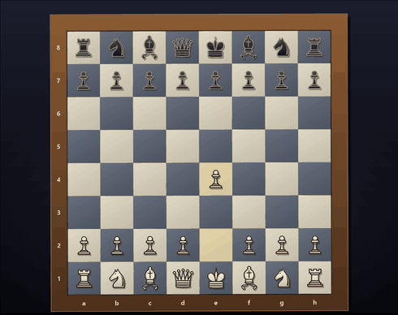

# Боевые шахматы

Шахматы для Windows в духе классической **Battle Chess**: при каждом взятии фигуры сходятся в анимированном поединке.
Два вида — аккуратная 2D-доска и режим «Battle Chess», который воспроизводит оригинальную игру для Macintosh (1991)
кадр в кадр: ходьбу, повороты, превращение ладьи в голема и все сцены поединков.

*Windows chess game inspired by Interplay's Battle Chess: a clean 2D board plus a frame-accurate port of the 1991 Macintosh
Battle Chess engine (moves, turns and all combat scenes) that runs on assets extracted from your own copy of the game.*



## Скачать
Готовая сборка — на странице [Releases](https://github.com/Lilbonner/battle-chess/releases): распакуйте архив и запустите
`BattleChess.exe`. Один файл, установка .NET не нужна (Windows 10/11, x64).

## Возможности
- Все правила шахмат: рокировка, взятие на проходе, превращение пешки, мат, пат, ничья по правилу 50 ходов,
  троекратному повторению и недостатку материала.
- Компьютерный соперник, 5 уровней: «Новичок», «Любитель», «Клубный игрок», «Мастер», «Гроссмейстер».
- Режимы: за белых, за чёрных, два игрока на одном компьютере, компьютер против компьютера.
- **Автоповорот доски для двух игроков**: после каждого хода доска с анимацией поворачивается к тому, чей ход.
- Отмена хода, подсказка, список ходов в русской нотации, звуки.
- Режим «Battle Chess» (нужны ресурсы из своей копии игры, см. ниже):
  - точные сцены всех 35 поединков оригинала — кадры, тайминг 10 кадров в секунду, звуки с исходной высотой тона;
  - для 26 пар фигур — до 4 дополнительных боёв, собранных по правилам движка оригинала из его же последовательностей;
  - ходы как в оригинале: поворот к цели, цикл ходьбы на каждую клетку, ладья превращается из башни в голема и обратно,
    конь идёт буквой «Г», а фигура на его пути отступает;
  - взятие по правилам `DOWALK`: жертва отходит на позицию боя, победитель выходит на свою и после боя возвращается в центр клетки;
  - пиксельный интерфейс в стиле Macintosh System 6 и диалог превращения пешки с картинками из оригинала.

## Скриншоты
Режим «Battle Chess»: перспективная доска оригинальной игры для Macintosh и пиксельный интерфейс в стиле System 6.

| Начальная позиция | Поединок: ферзь берёт пешку |
|---|---|
|  |  |

| Превращение пешки | Автоповорот доски для двух игроков |
|---|---|
|  |  |

<sub>На скриншотах — графика Battle Chess © Interplay из личной копии игры; сами ресурсы игры в репозиторий и релизы не входят.</sub>

## Режим «Battle Chess» и оригинальные ресурсы
Графика и звуки оригинальной игры принадлежат Interplay и **не входят в репозиторий и релизы**.
Если у вас есть своя копия Battle Chess для Macintosh (образ диска `BattleChess_1_0_2.dsk`), ресурсы можно извлечь
инструментами из папки [tools](tools/README.md) и положить папку `original` рядом с `BattleChess.exe` —
игра запустится в режиме «Battle Chess». Без неё доступна 2D-доска.
Как устроены данные и движок оригинала — в [docs/FORMAT.md](docs/FORMAT.md).

## Управление
| Действие | Клавиша |
|---|---|
| Ход | щелчок по фигуре, затем по клетке |
| Пропустить анимацию боя | Пробел / правая кнопка мыши |
| Battle Chess ↔ 2D | F2 |
| Перевернуть доску | F3 |
| Отменить ход | Ctrl+Z |
| Подсказка | Ctrl+H |
| Новая игра | Ctrl+N |
| Камера выше / ниже (Battle Chess) | Ctrl+PageUp / Ctrl+PageDown |

Автоповорот включается и выключается в меню «Вид → Автоповорот доски для двух игроков».

## Сборка
Нужен [.NET 9 SDK](https://dotnet.microsoft.com/download).

```bash
dotnet publish -c Release -o dist
```

Архив для релиза: `.\build.ps1 -Version 1.0.0` → `release\BattleChess-1.0.0-win-x64.zip`.

## Устройство
| Файл | Что внутри |
|---|---|
| `Chess.cs` | доска, генерация ходов, правила, нотация |
| `Ai.cs` | поиск альфа-бета с итеративным углублением, оценка позиции, уровни |
| `GameForm.cs`, `GameForm.Render.cs` | окно, меню, ввод, отрисовка доски и панели |
| `View.cs` | камера: 2D-доска, доска оригинала, переворот и анимация поворота |
| `Anim.cs`, `Battle.cs` | сценарии анимаций: ход, взятие, превращение |
| `OriginalArt.cs`, `OriginalMoves.cs` | загрузка ресурсов оригинала, движение и взятие по правилам его движка |
| `PixelUi.cs` | 1-битный интерфейс в стиле Mac |
| `Sound.cs` | синтезированные звуки и микшер waveOut |
| `Playtest.cs`, `DebugShots.cs`, `DebugPawn.cs` | автоматический плейтест и покадровая отрисовка для проверки |

Режимы командной строки для проверки без окна: `--playtest <папка> [партий] [ходов]`, `--shots <папка> [orig]`,
`--spin <папка> [orig]`, `--glyphs <файл.png>`.

## Правовая информация
Battle Chess — товарный знак Interplay Entertainment. Проект неофициальный, не связан с Interplay и не содержит
ресурсов оригинальной игры; скриншоты режима «Battle Chess» приведены только для иллюстрации.
